# F1 Strategy Board

**Mapping off-track operations to on-track performance.**

An EDA-heavy analytics platform that joins budget-cap spend, logistics, simulation / CFD, telemetry, pit stops and
weather to seven seasons of Formula 1 results (2019-2025), then ranks which off-track factors best explain race wins
and championship points.

> **Read this first: three of the five data sources are SYNTHETIC.**
> Race results, lap times, pit stops, tyre stints, standings and weather are real. Cost-cap spend, logistics and
> simulation / CFD data are not published by any team, so a documented, seeded generator stands in for them. Any
> finding that involves those sources shows the method working. It is not evidence about real teams.

---

## Contents

- [What it does](#what-it-does)
- [Architecture](#architecture)
- [Data provenance](#data-provenance)
- [Setup](#setup)
- [How to run](#how-to-run)
- [Screenshots](#screenshots)
- [Project structure](#project-structure)
- [The feedback loop](#the-feedback-loop)
- [Tests](#tests)
- [Limitations](#limitations)

## What it does

| Question | Where to look |
|---|---|
| What does each variable look like on its own? | Explore the data, Distributions tab |
| Does spend buy reliability? Does weather change pace? | Explore the data, Relationships tab |
| Which team-race rows are anomalous, and why? | Explore the data, Outliers tab |
| How do spend and results evolve through and across seasons? How fast do tyres fade? | Explore the data, Trends tab |
| Do teams fall into distinct operating profiles? | Explore the data, Team groups tab |
| Which factors move with points, wins, retirements and pit time? | What moves together |
| How likely is each car to retire? | Retirement risk |
| **Which factors best explain wins and points?** | **What drives results** |

Every chart is interactive Plotly with a one- or two-sentence note underneath, computed from the data on screen,
that leads with the finding. Every chart responds to the season, team and driver filters in the sidebar, and a
**Reset** button there clears them.

**Finding your way.** The sidebar groups the pages as *Data* (where it comes from, how it was cleaned), *Explore*
(the six EDA tabs, what moves together) and *Results* (what drives results, retirement risk). The Overview opens
with the short answer and links to the three most useful pages. Each tab opens with the question it answers;
secondary charts sit in *More charts* expanders so the main view stays short.

## Architecture

Seven layers, each a module in `src/` (the dashboard is `app/`).

```mermaid
flowchart LR
    subgraph S[1 Sources - sources.py]
        direction TB
        A1[Track timing and results<br/>REAL: Jolpica + FastF1]
        A2[Weather<br/>REAL: FastF1]
        A3[Financial / cost cap<br/>SYNTHETIC]
        A4[Logistics<br/>SYNTHETIC]
        A5[Simulation / CFD<br/>SYNTHETIC]
    end
    S --> B[2 Ingest - ingest.py<br/>schema alignment<br/>timestamp sync<br/>key joins]
    B --> C[3 Clean - clean.py<br/>missing values<br/>unit harmonisation<br/>outlier flags, keys]
    C --> D[4 EDA engine - eda/<br/>univariate, bivariate,<br/>outliers, time series,<br/>clustering, report]
    D --> E[5 Model - model.py<br/>correlation engine<br/>reliability scoring + SHAP]
    E --> F[6 Insights - insights.py<br/>ranked factor importance]
    F --> G[7 Dashboard - app/<br/>Streamlit, 8 pages]
    G -. anomaly watchlist .-> D
```

| Layer | Module | Responsibility |
|---|---|---|
| 1 | `src/sources.py` (+ `fetch.py`, `synthetic.py`) | Loaders for the five sources, with an offline fallback |
| 2 | `src/ingest.py` | Normalise team names to one id, join laps to results on driver code, attach weather to each lap with an as-of join on session time, build the analysis tables on `season, round, constructor, driver, component` |
| 3 | `src/clean.py` | Impute and flag gaps, convert currency / scale / km / tonnes, flag outliers without deleting them, add feature keys, log every step |
| 4 | `src/eda/` | `univariate`, `bivariate`, `outliers`, `timeseries`, `reduction`, `report` |
| 5 | `src/model.py` | Pearson / Spearman / partial correlation, statsmodels regression, gradient-boosting retirement risk with SHAP |
| 6 | `src/insights.py` | Consensus ranking of factors for wins and points across four methods |
| 7 | `app/` | Streamlit multipage dashboard |

`src/pipeline.py` sequences layers 1 to 3 (align, clean, join, then keys and flags) and caches the result.
`src/feedback.py` carries the anomaly watchlist from the dashboard back to the EDA layer.

## Data provenance

| # | Source | Origin | Provider | Grain |
|---|---|---|---|---|
| 1 | Race and sprint results, pit stops, standings, calendar | **REAL** | [Jolpica](https://github.com/jolpica/jolpica-f1) (Ergast successor) | driver x race |
| 1 | Lap times, tyre stints | **REAL** | [FastF1](https://docs.fastf1.dev) | lap |
| 2 | Weather (air and track temperature, humidity, wind, rain) | **REAL** | FastF1 weather channel | one sample per minute |
| 3 | Financial / cost-cap ledger | **SYNTHETIC** | `src/synthetic.py`, seed 42 | team x round x component |
| 4 | Logistics (freight, customs, spares, crew fatigue) | **SYNTHETIC** | `src/synthetic.py`, seed 42 | team x round |
| 5 | Simulation / CFD (wind tunnel, CFD, simulator) | **SYNTHETIC** | `src/synthetic.py`, seed 42 | team x round |

**How the synthetic data is made.** The generator reads the real results, calendar and pit stops and plants loose,
noisy relationships with them (the full list is `PLANTED_EFFECTS` in `src/synthetic.py` and on the How it works page).
It respects two public rules: the cost-cap level per season and the sliding aero-testing allocation by previous
championship position. Travel distance is computed from real factory and circuit coordinates. It also adds the mess
a real data team would face: different team spellings per source, mixed currencies and scales, kilograms next to
tonnes, about 3% missing values, a few gross outliers and duplicated ledger rows.

**How synthetic data is labelled.** Every synthetic row carries `data_origin = "SYNTHETIC"`; generated files are
named `SYNTHETIC_*.csv`; synthetic factors are badged or starred on every chart and table; and the What drives results
page includes a *planted-effect recovery check* that tests the engine against the generator's known ground truth.

**Caching and offline use.** Real data is cached in `data/raw/`. If that folder is empty, for example on a machine
with no network, the app runs on the small real-data bundle in `data/sample/` (all results and pit stops, plus lap
and weather data for two races per season).

## Setup

Requires Python 3.11 or newer.

```bash
python -m venv .venv
# Windows: .venv\Scripts\activate      macOS / Linux: source .venv/bin/activate
pip install -r requirements.txt
```

Optional extras (UMAP embedding, ydata-profiling report): `pip install -r requirements-optional.txt`.

Or let the run script do it: `.\run.ps1` on Windows, `./run.sh` on macOS / Linux, or `make setup`.

## How to run

```bash
streamlit run app/Home.py
```

The app works immediately on the bundled sample. To use the full dataset, download it first:

```bash
python -m src.fetch                       # all seasons; lap data for 6 evenly spaced races per season
python -m src.fetch --laps-per-season 0   # lap data for every race
```

FastF1 limits itself to 500 API calls an hour (roughly 45 race sessions). When the limit is reached the fetcher
stops cleanly; run the same command again an hour later and it resumes. Nothing is downloaded twice.

Other commands:

| Command | What it does |
|---|---|
| `python -m src.pipeline` | Rebuild the cleaned, joined tables |
| `python -m src.eda.report` | Write `reports/eda_report.html` plus Markdown and JSON findings |
| `python notebooks/build_notebook.py` | Rebuild and execute the walkthrough notebook |
| `python -m pytest` | Run the tests |
| `python -m src.fetch --make-sample` | Rebuild `data/sample/` from `data/raw/` |

The same tasks are available as `make data`, `make build`, `make report`, `make notebook`, `make test`, `make run`.

## Screenshots

Captured from the running app with `python scripts/capture_screenshots.py`.

| | |
|---|---|
| **Overview** 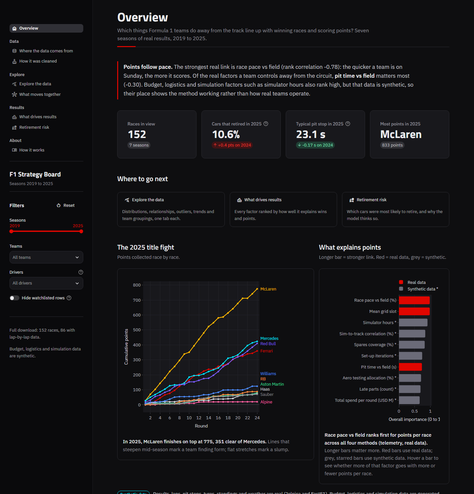 | **What drives results** 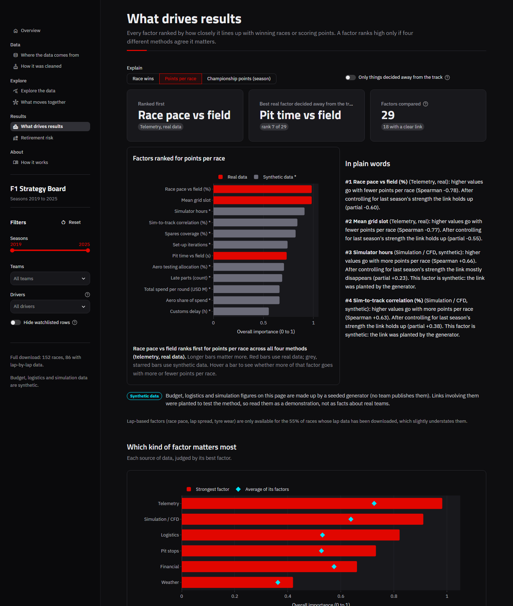 |
| **Explore: relationships** 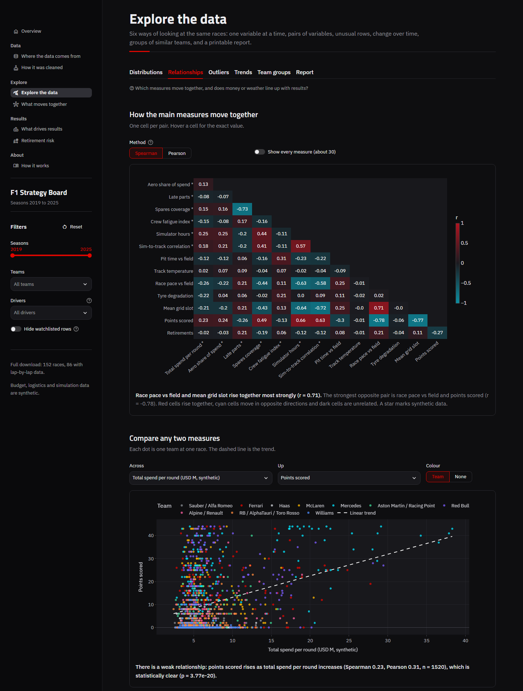 | **Explore: outliers and watchlist** 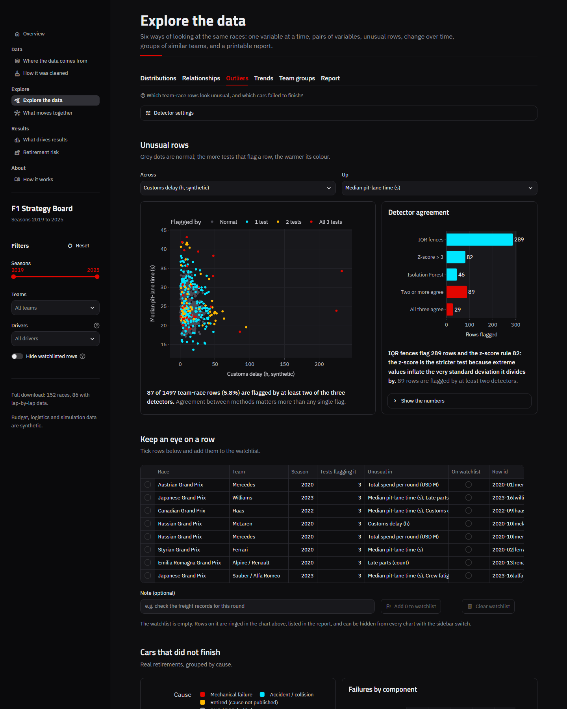 |
| **Explore: trends** 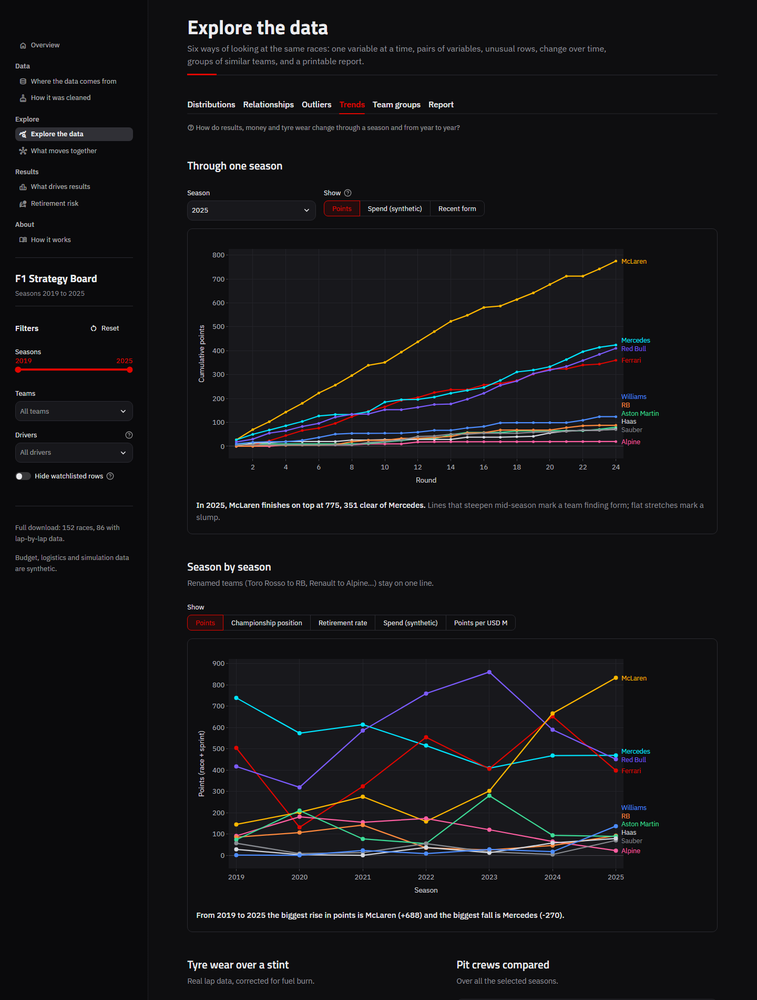 | **Explore: team groups** 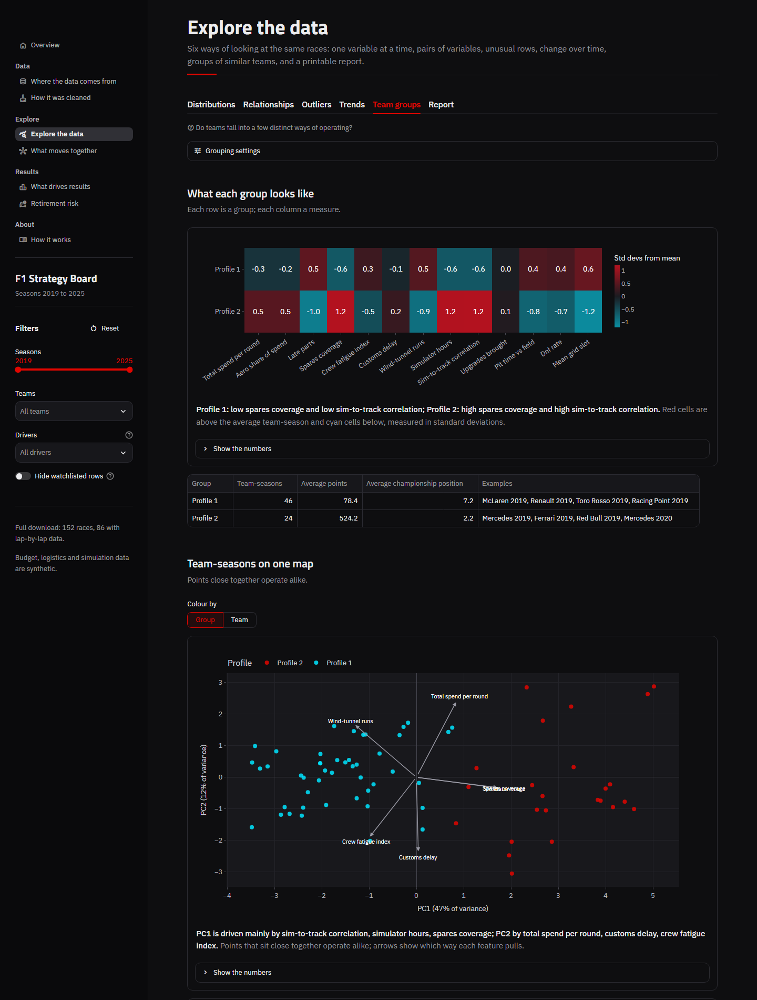 |
| **What moves together** 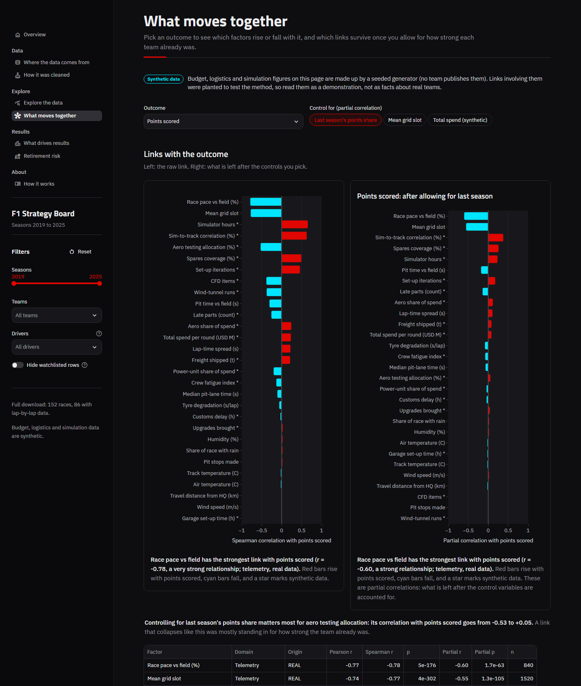 | **Retirement risk** 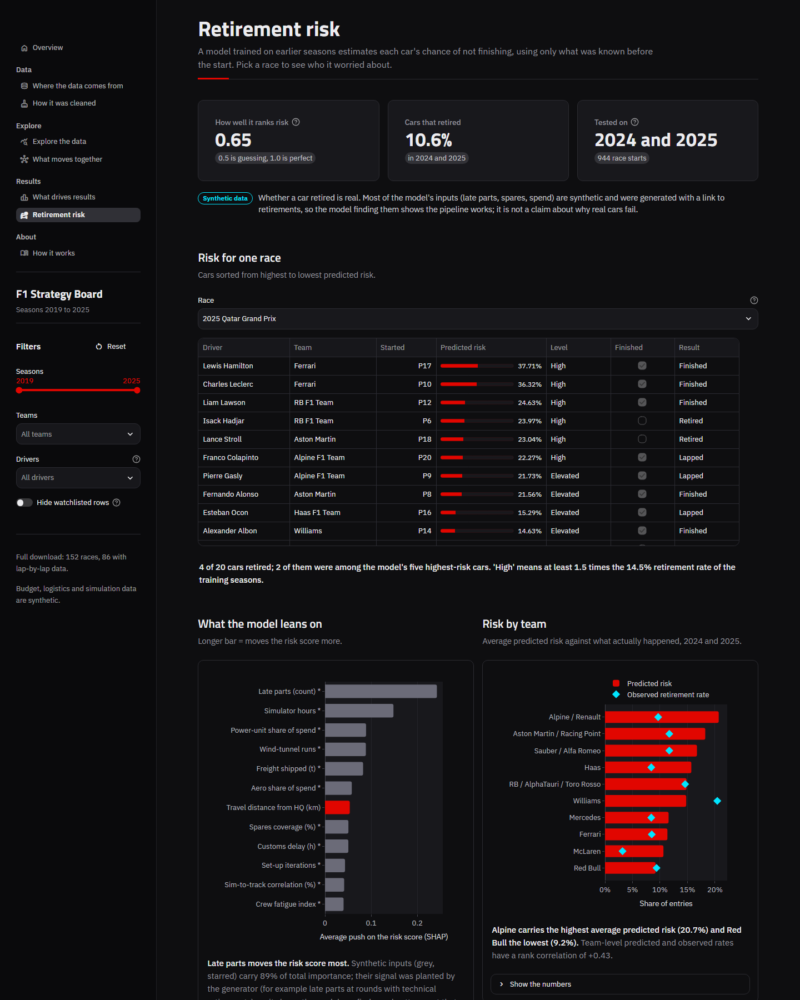 |
| **How it was cleaned** 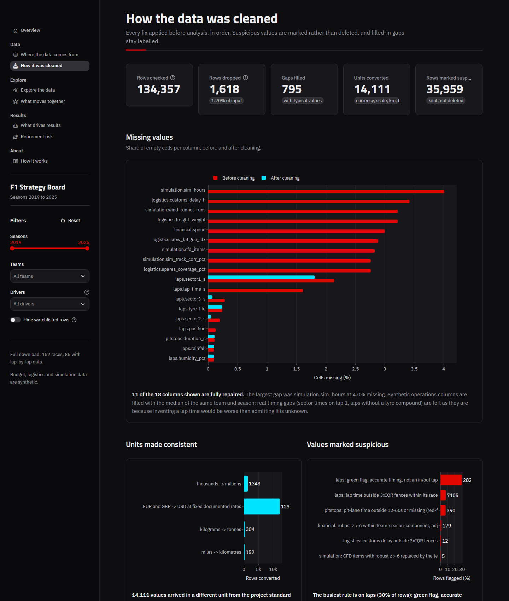 | **Where the data comes from** 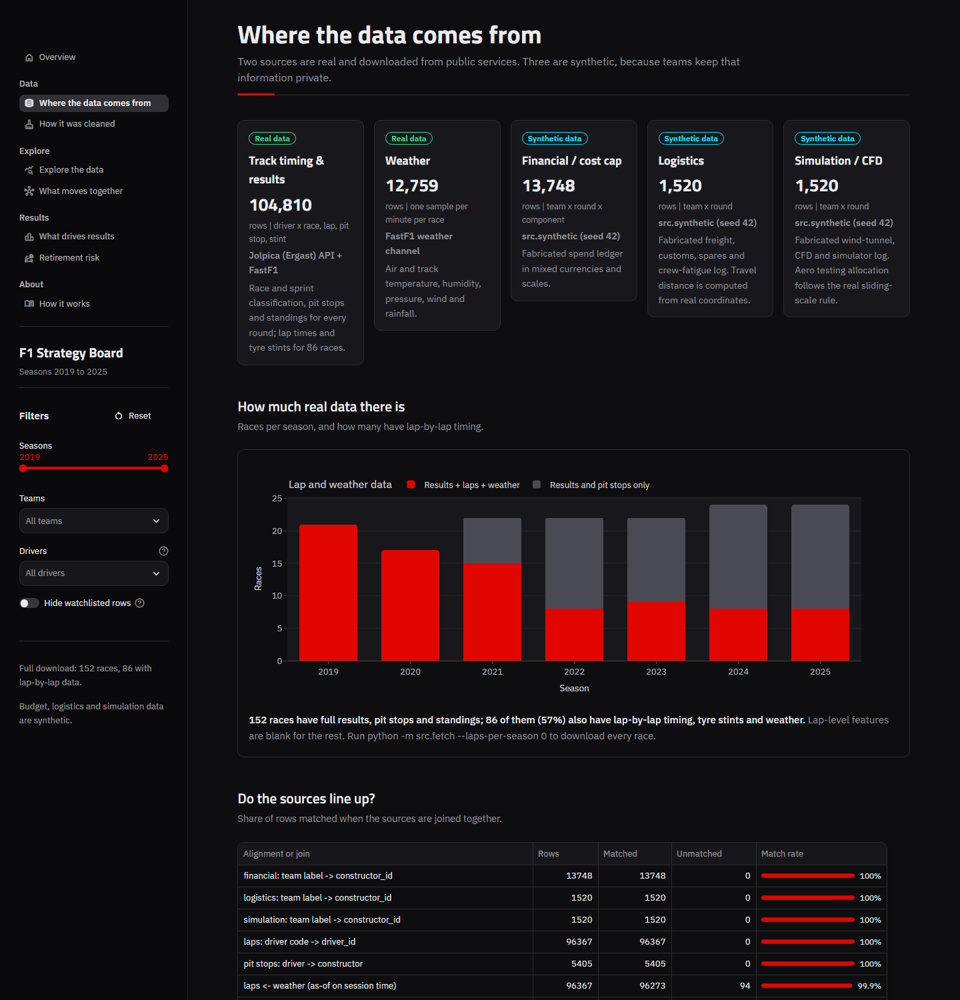 |

## Project structure

```
EDA/
├── app/
│   ├── Home.py                  # entry point: theme, sidebar filters, navigation
│   ├── ui.py                    # shared helpers: header, KPI cards, chart cards, cached data
│   └── app_pages/               # overview, data_sources, cleaning_report, eda_explorer,
│                                # correlations, reliability_risk, ranked_insights, methodology
├── src/
│   ├── config.py                # paths, seed, palette, team metadata
│   ├── fetch.py                 # network: Jolpica + FastF1 -> data/raw
│   ├── synthetic.py             # SYNTHETIC generator for finance, logistics, simulation
│   ├── sources.py               # layer 1: the five loaders
│   ├── ingest.py                # layer 2: align, sync, join
│   ├── clean.py                 # layer 3: units, gaps, flags, keys
│   ├── eda/                     # layer 4: univariate, bivariate, outliers, timeseries, reduction, report
│   ├── model.py                 # layer 5: correlation engine + reliability scoring
│   ├── insights.py              # layer 6: ranked factor importance
│   ├── pipeline.py              # runs layers 1-3 and caches the tables
│   ├── feedback.py              # anomaly watchlist (dashboard -> EDA)
│   ├── taxonomy.py              # team-name and retirement-status vocabularies
│   └── theme.py                 # the shared Plotly template
├── notebooks/
│   ├── 01_eda_walkthrough.ipynb # narrated EDA, all six steps, executed
│   └── build_notebook.py        # regenerates the notebook so findings match the data
├── tests/                       # ingest, clean, outlier logic, pipeline, dashboard smoke tests
├── data/
│   ├── sample/                  # small real-data bundle (offline fallback)
│   ├── raw/                     # download cache (git-ignored)
│   ├── synthetic/               # generated SYNTHETIC_*.csv (git-ignored)
│   ├── processed/               # cached analysis tables (git-ignored)
│   └── watchlist/               # anomaly watchlist written by the dashboard
├── reports/                     # generated EDA report
├── assets/                      # style.css, screenshots
├── scripts/capture_screenshots.py
├── .streamlit/config.toml       # theme
├── requirements.txt             # pinned
├── Makefile, run.ps1, run.sh
└── README.md
```

## The feedback loop

Anomalies flagged in the dashboard flow back into the EDA layer:

1. On **Explore the data > Outliers**, three detectors (IQR fences, z-score, Isolation Forest) vote on every team-race row.
2. Tick rows in the anomaly table, add a note and press **Add to watchlist**. They are written to
   `data/watchlist/watchlist.csv`.
3. The EDA layer reads the watchlist on its next pass: watchlisted rows are ringed on the anomaly chart, listed in
   the generated report, and the sidebar switch **Hide watchlisted rows** re-runs every analysis without them.

## Tests

```bash
python -m pytest
```

| File | Covers |
|---|---|
| `tests/test_ingest.py` | Team-name normalisation, schema alignment, as-of weather sync and its tolerance, slope fitting, one-row-per-key joins |
| `tests/test_clean.py` | Status classification, currency / scale / km / tonnes conversion, imputation flags, clean-lap rules, pit-stop validity, feature keys |
| `tests/test_outliers.py` | IQR fences, z-score, robust (MAD) score, grouped detection, Isolation Forest, the three-way vote, watchlist round trip |
| `tests/test_pipeline.py` | Offline fallback to the sample, key uniqueness, points reconciling with official standings, seeded synthetic output, partial correlation, ranking, time-ordered model evaluation |
| `tests/test_app.py` | Every page and every EDA tab renders without an exception, including under narrow filters |

## Limitations

1. **Three of five sources are synthetic.** Rankings that involve budget, logistics or simulation reflect what the
   generator planted. They demonstrate the platform; they say nothing about real teams.
2. **Association, not causation.** Points fund budgets as much as budgets buy points. Partial correlation and
   regression reduce confounding; they cannot remove it.
3. **Retirement causes are not published from 2023.** The public feed logs most recent retirements as plain
   "Retired", so component-level failure analysis covers 2019 to 2022 and the reliability model predicts any
   retirement, mechanical or not.
4. **Weather cannot explain between-team gaps.** All teams share the same weather in a race, so it ranks last for
   points and wins by construction. Its real effect is on field-wide pace, tyre wear and retirement risk.
5. **Lap-level coverage depends on what has been downloaded.** Results, pit stops and standings cover every race;
   lap, stint and weather features exist only for races fetched through FastF1 (the sidebar shows the count).
6. **Small samples at season level.** Ten teams a year gives about 70 team-seasons.
7. **Approximations.** Fuel correction is a fixed 0.055 s per lap; pit times are pit-lane times, not stationary
   times; travel distance is factory to circuit; cause-unknown retirements count as half a technical failure when
   the generator plants its reliability link.
8. **Retirements are mostly chance.** The risk model ranks a little better than random on unseen seasons
   (ROC AUC around 0.65). It is a ranking aid, not a predictor of individual failures.

---

Unofficial project. Not associated with Formula 1, the FIA or any team.
